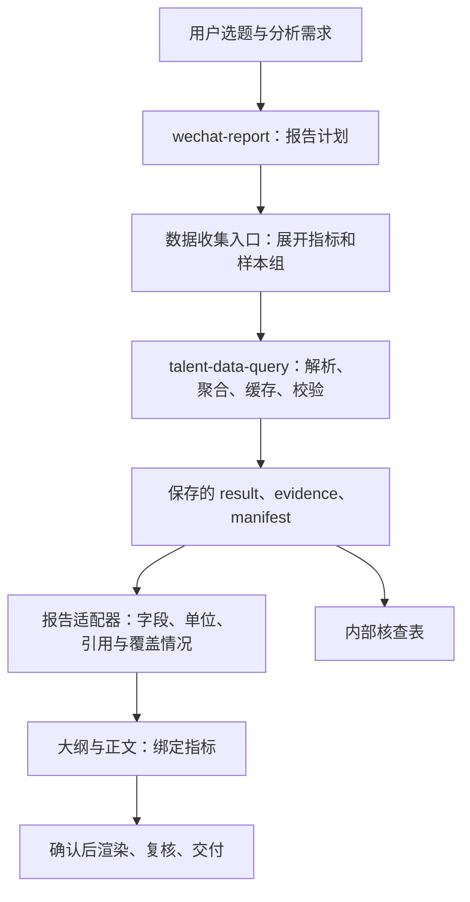

# 087 · 报告智能体接入共享人才查询：计划、适配与证据绑定

**状态**：设计方案，待实现（2026-11-02）。以 wechat-report 为首个报告适配目标，复用 085/086 已实现的查询入口。本轮只核对代码、验证基础请求和编译计划、记录设计；没有迁移业务代码、扩展查询指标、重启服务或修改数据库。现有接口与拟新增协议在下文分别标注。

## 动机

报告智能体需要根据问题组织分析，数据层需要稳定筛选、减少扫描并统一证据。现有 wechat-report 自行用 PyMySQL 拉取描述明细并在 Python 聚合，和共享统计工具并存；仅在 SKILL.md 中写“先调用另一个 Skill”，仍会留下两套口径和取数入口。采用同一报告智能体调用确定性查询工具，再通过报告适配器组织数据。

目标调用关系：



这里的“调用共享 Skill”是读取数据能力规范、执行已声明 CLI；主 Skill 仍是 wechat-report，无须另起模型会话或子智能体。数据库层不负责文章结构、课程建议或图表配色。

## 代码现状与接入位置

以下 file:line 为本轮核对的**既有代码**，不是拟新增模块已经实现的证明。

| 现有位置 | 事实与迁移要求 |
|---|---|
| `web/server/index.ts:105`、`:127`、`:141` | 已在数据库配置齐备时向会话声明共享 CLI 和 Skill 文档；新目录不会因此成为自动加载的主 Skill。该声明源码已有，085 所述共享查询低权端到端验收仍待做 |
| `web/server/index.ts:137` | 兼容白名单仍有“必须优先”的旧提示；迁移时需明确已迁移报告走共享入口，避免与新报告指令冲突 |
| `web/server/lib/piRunner.ts:533`、`:680` | 显式加载选中的主 Skill，首轮展开 `/skill:<name>`；共享数据依赖不替换这个主流程 |
| `web/server/lib/skills.ts:185`、`:193` | wechat-report 已有入口；共享查询尚非前端独立卡片，不需要为报告接入新增卡片或表单 |
| `.agents/skills/wechat-report/SKILL.md:24` | 仍要求一次拉回全部字段，应替换为声明统计需求、消费共享结果的工作流 |
| `.agents/skills/wechat-report/scripts/fetch_data.py:130`、`:167`、`:238` | 独立配置、PyMySQL、行级主扫描；新真实查询路径不再经过这里 |
| `.agents/skills/wechat-report/scripts/fetch_data.py:363`、`:461`、`:496` | 旧分布复核、旧薪酬算法和岗位×技能矩阵，不能仅改连接调用就视为已兼容 |
| `.agents/skills/wechat-report/scripts/report_common.py:45`、`:72` | 经验标签和派生指标需改为消费共享语义，移除“3年以内→1–3年”等改写及未成立的固定结论 |
| `.agents/skills/wechat-report/scripts/verify_data.py:260`、`:285` | 当前按旧字段做全量对账、用全局数字池核对文案；接入时改为按实际覆盖章节和指标引用核验 |
| `.agents/skills/wechat-report/scripts/evidence_sheet.py:159` | 当前重建 SQL；应直接消费共享 evidence 的真实查询，区分实际执行与拟复核语句 |
| `scripts/talent-data/compile.mjs:78`、`:91`、`:107` | 现有编译器可将低基数维度合为 cube，薪酬取中点频数；多组纯计数以外仍按 cohort 分别编译 |
| `scripts/talent-data/artifacts.mjs:52` | readResult 核对 manifest 与 contentHash；inspect/export 不查库，可用于后续报告阶段消费已保存结果 |

## 一、职责分配与部署

| 层 | 负责内容 | 不应承担的内容 |
|---|---|---|
| wechat-report 主智能体 | 明确地域/产业/名称/时间、读者、研究问题、章节和论证；解释已验证指标 | 数据库连接配置、任意 SQL、改写统计事实 |
| 报告收集与适配代码 | 按章节展开受支持指标、生成请求、检查能力/状态、字段适配、引用绑定、覆盖清单 | 第二套薪酬清洗、文本匹配或行业归类算法 |
| talent-data-query | 实体解析、过滤、统计、算法版本、调度、缓存、快照、实际证据和计量 | 微信排版、文章风格、教育建议 |
| 渲染/文章/核查表 | 从绑定结果生成文件与校验；核查表消费真实 evidence | 为补图表私自重新查库，或从旧样例补缺指标 |

部署侧在既有受信入口基础上，拟增加显式数据依赖声明（例如 `wechat-report → talent-data-query` 的项目级注册表）。依赖声明用于提供共享说明与绝对 CLI 路径、启动前检查可用性；不意味着把依赖注册成主会话、前端卡片或无条件向所有离线 Skill 注入实时模式。具体注册字段待实现时确定，当前没有这项元数据。

首次接入采用仓库内现有 CLI，收集脚本通过参数数组启动 Node，共用其队列/缓存/配置；不复制查询源码和 `.env`，不引入新 HTTP/MCP 服务。执行路径来自受信部署配置，不接受用户报告 JSON 指定可执行程序。Python 继续负责原有渲染链，不需要承担 Node 查询模块的逻辑。

现有共享配置机制不等于凭据已隔离，沿用 078/085 的真实部署边界。低权账号必须验证共享状态目录可写、安装目录和查询依赖可读、工件落入本会话；开发用户成功不能代替这项验证。

## 二、从报告计划生成一次完整统计请求

拟新增业务输入 `wechat-report-plan/1`，包含：

- `filters`：与共享查询一致的地域、产业/岗位类型、名称、学历/经验、平台更新时间等语义；先解析歧义，再冻结实际实体 ID 和日期边界。受众不会改变筛选。
- `sections[]`：请求的章节、必需/可选属性；例如总览、地域、学历经验、薪酬、职教池、赛道、能力画像。
- `audience`：读者与分析重点，影响文章，不进入查询缓存键。
- `freshness`：按用户意图选择 live/cache-ok；报告后续阶段读取本地工件。
- `onMissingOptional`：省略该节并列出缺口；必需指标缺失时返回未完成状态，不能标成完整报告。

这是报告业务协议的设计字段，不是当前 talent-query/1 接受的新字段；必须经收集代码展开成实际受支持的请求。实施顺序是：章节依赖闭包 → capabilities 校验 → 一次请求声明总体及必要子样本的指标 → 运行统计。能力不支持的必需项在昂贵查询前说明；基础版与完整版使用不同的章节清单。

时间窗必须显式记录。用户要求全时间范围时不保留旧脚本默认近 365 天；选择近期时先转换成固定 updatedAt 边界。产业树、岗位类型树与“名称包含”不可互换，旧机器人样例是名称口径，不能与机器人产业子树结果直接比较。不同来源的过滤语义变化记录为新报告版本。

### 当前接口已接受的基础请求示例

以下请求只使用已注册的 11 类指标，提供总体与职教宽口径入门池。具体报告只请求需要的章节；未涉及来源和岗位名排名时不额外请求 source.distribution/title.top。它不是包含赛道与技能的完整版请求。

```json
{
  "schema": "talent-query/1",
  "sourceId": "talent-main",
  "cohorts": [
    {
      "id": "all",
      "filters": {
        "region": {"level": "province", "name": "广东省"},
        "industries": [{"id": "15", "includeDescendants": true}]
      }
    },
    {
      "id": "vocational",
      "filters": {
        "region": {"level": "province", "name": "广东省"},
        "industries": [{"id": "15", "includeDescendants": true}],
        "education": ["DAZHUAN", "GAOZHI", "ZHONGZHUAN/ZHONGJI", "GAOZHONG", "CHUZHONGJIYIXIA", "BUXIAN"],
        "experience": ["ON_CAMPUS", "GRADUATING", "LESS_THAN_1", "BUXIAN"]
      }
    }
  ],
  "metrics": [
    "positions.count", "companies.count", "data_quality.summary",
    "city.distribution", "education.distribution", "experience.distribution",
    "jobType.distribution", "education_experience.cross", "city_education.cross",
    "salary.summary", "salary.distribution"
  ],
  "execution": {"freshness": "live", "timeoutMs": 180000, "deadlineMs": 360000},
  "output": {"topN": 100, "previewRows": 0, "exports": []}
}
```

使用当前编译器及既有已解析实体，本轮验证生成 **6 条统计 SQL**：每组 base / cube / salary 各一条。cube 包含省、市、学历、经验、招聘类型，支持从同一组频数导出边际与交叉。此为请求及编译计划验证，**没有重跑聚合或测得 6 条版耗时**；不能把此前 10 条版耗时按比例认作实测。

报告关注的样本变多时仍遵守现有最多四组限制；多个产业也不能强行装入超限请求。确需多个请求时记录独立读取批次，不宣称它们在同一数据库快照。

## 三、报告数据适配与单一来源

第一阶段保留既有渲染所需的 `report_data.json` 字段结构，拟新增 `report_binding.json`；不让各 Python 脚本分别解析查询结果。拟增加 `.agents/skills/wechat-report/scripts/collect_data.mjs` 和 `adapt_query_result.mjs`：前者构造请求并调用共享 CLI，后者消费已核验工件生成兼容数据和绑定。两者目前未创建。

绑定文件拟采用 `wechat-report-binding/1`，最小内容为：

| 字段 | 用途 |
|---|---|
| `adapterVersion / planHash` | 固定适配规则与报告需求 |
| `source` | 实际 requestId、snapshotId、contentHash、dataReadAt、engine、原工件路径与 manifest 的 SHA-256 |
| `reportDataSha256` | 绑定实际生成的 report_data.json |
| `fields` | 兼容字段 JSON Pointer → source metricId、value/row 选择器、单位转换/派生公式版本 |
| `coverage[]` | 每节 required/optional、complete/empty/unavailable/failed/unsupported、原因与依赖指标 |
| `validation` | 结构对账、独立复核、文案引用、渲染检查各自状态；没有执行的项不填 pass |

正文 claim、图表数据分别引用 metricId 和明确的维度键/字段选择器；派生指标引用输入 metricId 列表及固定公式版本。例如岗位总数引用 `all/positions.count` 的 value，某城市数引用省市维度键匹配的行。不能仅判断数字在输入中出现过；把企业数写成城市岗位数必须失败。

适配要求：

1. 统计层的 share 为 0–1，旧 pct 为 0–100，只做一次显式转换；底层精度保留，展示舍入单独记录。
2. 城市数不能用 TOP N 行数推算。当前基础请求包含完整的 city_education.cross，可从省、市非空的完整交叉频数计算不同省市键数，包含学历缺失桶；其他情形须增加受支持的完整来源。地域排名保留 other/missing，不把未展示城市当作零。
3. 缺失/未知学历经验不丢弃，也不改为“不限”；LESS_THAN_3 显示“3年以内”，不复用旧互斥年限标签。职教池按原始枚举行级 AND 筛选，不由学历占比×经验占比估算。
4. 薪酬明确采用共享 salary-policy/1：保留小数、100K 上限、线性分位数、现行六档。适配图文与图例，不强行伪装为旧 500K 上限/整数化/七档算法的相同指标。需要其他分箱时先在共享层新增版本和验收。
5. 缺失的赛道/技能模块不写成“其他=全部”或零技能。应在 coverage 记录，并让 gen_outline/report_common 按已完成章节工作；现有直接下标访问和无条件校验须随基础版迁移一起修改。
6. 结果验签/哈希检查证明工件一致，不代表 SQL 业务语义天然正确。正文和图表绑定、适配派生复算、独立 SQL 参照各有自己的验证状态。

## 四、按报告需求扩充通用统计能力

新增指标须在共享注册表、请求校验、方法/版本、缓存键与证据中一起实现，并由 capabilities 发布。下表的英文名称仅为**拟议能力名**，当前不能提交给 query；分析策略参数的具体 schema 在实现前定稿。

| 报告需求 | 拟补充共享能力 | 计算与复用原则 |
|---|---|---|
| 赛道结构 | track.distribution | 版本化分类策略；从具体到通用取唯一主归属；与重叠产业标签分布区分，保留未分类项 |
| 城市×赛道 | city_track.cross | 与赛道分布使用同一分类器，输出完整有界交叉频数及缺失；不可直接用 TOP6 数据当全省分母 |
| 分赛道薪酬 | salary_by_track.summary | 同一分类器、同一薪酬策略；按赛道×薪资状态×中点频数推导，而非每个赛道独立扫库 |
| 技能词与岗位×技能 | skills.distribution / track_skills.cross | 版本化词典，明确大小写、词界/子串、同义词和分母；一次命中每岗位每词计一次，词频加总不称独立岗位数 |
| 职教池专题 | 同能力应用于 vocational cohort | 条件与总体兼容，池内赛道、薪酬、技能不能从总体占比推算 |
| LQ | 从完整城市×赛道频数派生 | 固定“本市赛道占比 ÷ 区域赛道占比”公式与输入引用，零分母返回 unavailable；派生模块可复用，不额外查库 |

词典与分类配置应属于共享层的有版本分析策略，支持按产业选择或受控用户词表，而不是复制旧 AI PRIORITY/TRACK_GROUPS 到每个报告 Skill。旧词典可注册为明确的 legacy 策略，以便复现；未知产业未有合适策略时不能自动套 AI 分类。

技能统计仍只向报告返回计数/比例/缺失等聚合信息。执行层可对已筛选集合进行有界服务端条件聚合；若不得不内部分块处理文本，须受控、同一一致性约定并证明覆盖完整，超限则标未完成，不能用抽样冒充全量。不能按每个词、每个赛道各发一条 SQL；不能把岗位 description 传给模型逐行统计。数据库中的文本是数据，不执行其中内容。

基础能力复用和新模块全量统计应在同一结果包/只读一致性事务内完成。先跑基础、几分钟后另查技能的两阶段产品可用于探索，但必须明确独立读取批次；若要出单一完整口径的正式版，重新生成包含全部所需指标的同批次结果，或在后续受控快照产品中证明一致性，不能合并现有不同内容请求的 snapshot-only。

## 五、性能与报告生命周期

- **计划按需**：不请求与所选章节无关的来源/名称排名/交叉；优先复用低基数 cube。来源、标题等高基数字段不要混入巨型 cube。
- **同组复用**：纯计数目前已能合并；薪酬/技能多组共享扫描需在共享层另行实现及对账，不把“一次 CLI 调用”等同于“一次物理扫描”。
- **缓存按数据条件复用**：保留现有完整请求/源/版本键与队列，报告风格变化只重写/重渲染，不改查询条件。缓存命中保留实际读取时间；live 才刷新。
- **保存后锁定内容**：大纲生成、用户确认、渲染和复核消费已保存的 result/manifest。现有查询缓存与 snapshot-only 只有最长 15min 新鲜度，而本地 inspect/适配读取不受此 TTL 控制；几小时后确认大纲不需要重新查询。长时间后主动刷新会产生新报告修订及绑定，重新核对受影响结论。
- **关键复核按预算执行**：保留 base/cube/salary 的结构对账；对关键总量与交叉选择少量不同 SQL 路径，在同一个只读事务内复核并留证。新增复核配置和实现前，只能称当前检查为结构/总量对账，不能声称通过旧流程要求的全部独立复算。
- **计量沿用真实边界**：报告收集入口用单调时钟记录完整时间，另存 queueMs、sqlBatchMs、返回字节/组数、适配耗时和缓存模式。现有逐语句 elapsedMs 不可靠，见 085/086。6 条 SQL 是当前编译结果，不是耗时承诺；完整模块和不同时间过滤仍需实测。
- **证据不重建**：核查表从 evidence 的 queryId、SQL、原聚合值、批次耗时生成，未可靠测量的逐语句时间填未测。渲染不查库；公开交付不包含内部 SQL 工作簿。继续按 083 修复工件完整性、错图与裁切，不因数据接入成功声称报告已验收。

## 六、实施顺序与验收

1. **基础版闭环**：为 wechat-report 声明共享依赖，替换 SKILL.md/安装文档和回落提示中的直连步骤；实现收集入口、11 类基础指标的兼容适配及绑定。同步改造 report_common/gen_outline/verify 的缺模块、空数据、无有效薪酬与指标引用边界，否则仅替换 fetch_data 不可用。真实路径关闭旧 fetch_data 自动回退，演示数据仍只在用户明确要求时使用。
2. **完整统计模块**：在共享层登记版本化分类/技能策略及交叉、分组薪酬；收集入口按所选章节展开请求。LQ 使用完整交叉结果确定性派生。每项通过数据口径与性能验证后才开放。
3. **证据与最终交付**：evidence_sheet 消费真实 evidence；正文/图表绑定与数据检查、渲染后验收分开；内部/公开工件清单分别消费。渲染、文章、打包需要绑定相同数据与大纲版本；复用 083 审查事实修复必需缺陷。
4. **运行环境与推广**：真实低权 Pi 从主报告 Skill 调用共享 CLI，验证读库/状态目录/超时/会话隔离和工件落点；再把同一接口适配到 career-guidance、tech-forecast。离线报告模式沿用原契约，不自动迁移。

需要的有意义验收：

- 同一新口径样本，独立参照与共享/适配的计数、企业、薪酬和交叉一致；若与旧指标不同，定位为筛选或算法版本变化，不能强求历史数字相同。
- 非广东省份、单城市、非 AI 行业、零岗位、缺描述/缺薪资/未知枚举、截断城市排名正常；无条件模板不再崩溃或补写虚构数据。
- 企业数被写成城市岗位数、篡改 report_data、错误引用另一 cohort、图表与正文不同版本均须失败。
- 总体与职教池同批次；技能缺失/超时不变成 0；必需模块未完成时不能交付为完整报告。
- 大纲确认超过 15min 后，从已有工件渲染不访问数据库；主动刷新创建新修订；同条件缓存保留原读取时间。
- 比较基础版与完整版的 live 完整请求时间、SQL 数、返回量；索引未建立时不把收益归因于索引。不把缩减 SQL 条数直接宣称为同比例提速。
- 真实低权 Pi 验证在部署后执行；服务/权限未验收时如实保留 pending，不能用当前开发用户结果替代。

**本轮验证**：基础 JSON 请求通过实际 validateRequest 校验；planQuery 完成实体解析与计划编译，生成 6 条 SQL、两组样本，executesAggregates=false，未执行统计聚合。文档路径/既有 file:line 与索引检查通过。未新增实现代码，因此没有把旧测试结果当成本方案实现验收。

## 成本与取舍

- **采用确定性 CLI + 兼容适配器**：保留现有 Python 渲染链，数据语义只有一处。代价是过渡期维护旧字段和新引用的映射，并要修复依赖“所有字段必有”的模板；否决只改一行提示词就宣称已经解耦。
- **采用按章节扩展的指标包**：让同一数据层服务不同报告，减少无用计算；需要维护能力依赖及版本。否决固定把全部字段/全部指标给每份报告，也否决把尚未实现的模块填为零。
- **统一算法并显式修订历史口径**：会改变旧报告部分数字和图例，换取可复用、可说明的定义。否决在适配器里偷偷恢复整数化/500K 上限或名称与产业混用。
- **保存数据包支撑后续编辑**：占用工件空间，需要保留和清理策略；换取用户确认后数字稳定、审计可追溯。否决每一步都实时刷新，或用已过期 snapshot-only 作为本地文件读取方式。
- **先复用当前部署**：不新增服务、连接池或 Agent 调度，缩小接入成本；低权权限与既有凭据边界仍需验收。将来多主机调度或强凭据隔离确有需求，再把稳定结构化协议迁到服务端执行接口。

## 后续扩展路线

基础版 → 分类/技能与完整交叉 → 证据和最终交付 → 其他实时报告适配。共享查询继续维护其注册能力，报告 Skill 只维护需求与展示适配。数据库索引与预汇总按 086 独立评估，不成为基础接入的前置条件。实现落地时回填本记录中拟议模块的真实 file:line、协议字段及验收结果，并修改状态。
