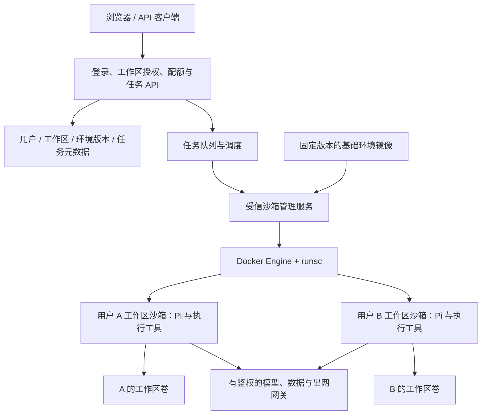

# 119 · 多用户工作区、环境模板与 gVisor 执行边界

**状态**：设计建议，待产品范围确认与实现（2026-11-10）。本机 gVisor 安装和基础运行已验证；本文的多用户系统、资源保障及环境管理未实现。本次只记录方案，不改运行配置。

## 动机与范围

用户准备面向外部用户提供相互隔离、可配置基础环境的执行服务。Docker 管理容器，gVisor 提供执行隔离，身份授权、持久存储、环境版本、网络策略和配额需要平台管理。首版按“选择平台模板并安装项目依赖”提出建议；是否开放系统软件、自定义镜像和持续网页服务尚待用户选择，不视作已批准实现。

建议以**工作区**作为权限、文件和环境的归属单位，以**沙箱**作为按需创建的运行实例。一个用户可拥有多个工作区，不同用户不共用一个 gVisor sandbox。首版工作区可以与 clientSessionId 一对一，后续再扩展跨会话共享。

## 已核对的现状

- `web/server/lib/piRunner.ts:532` 的 createSession 构造本机 Pi RPC 子进程，`:573` 选择 sudo 或直接 spawn，尚未调用 Docker/runsc。安装 gVisor 不会自动改变广场执行链。
- `web/server/index.ts:204` 根据 clientSessionId 在 `web/server/workspace` 建目录并设 2775；`scripts/setup-pi-sandbox.sh:100` 把整树交给同一 plaza-run 组，`:106` 声明沙箱账户可读 web/.env。不同 cwd 和共同低权账户不能构成租户隔离；078 仍是宿主机写权限收敛措施。
- `web/server/lib/browserHistory.ts:5` 根据客户端 x-plaza-browser 产生前缀；`web/server/lib/traceExport.ts:149` 的 RunRecord 尚无 tenantId/ownerUserId/workspaceId。浏览器历史前缀不能充当登录身份或资源归属授权。
- `web/server/lib/modelRelay.ts:8` 已把传入的模型密钥留在服务端并生成独立随机路由，但 `:47` 只监听宿主机 127.0.0.1。容器的 localhost 不能访问此代理，须改成受限网关，不能用 host 网络模式绕开隔离。现有代理不代表所有模型/数据库凭据均已隔离。
- `web/server/lib/piRunner.ts:543` 使用工作区 .pi-sessions 并 --continue 恢复；`:613` 销毁本机通道。容器化需同时处理路径、恢复、取消与孤儿回收。

## 组件关系

API 管身份、归属授权、限额及交付。仅受信管理服务访问 Docker socket；浏览器、Pi 和用户脚本都不能控制原始 Docker 参数。管理服务把 workspaceId/environmentRevisionId/runId 解析成固定镜像、挂载和限额，拒绝用户指定任意宿主机路径、privileged、设备、host 网络/PID 模式。Pi 及 bash/read/write 等执行工具进入沙箱，JSONL 经管理服务桥接回现有 SSE。

控制服务与执行 worker 至少分开进程、凭据及权限；单机可验证原型，公网生产建议采用专用执行机器/节点，减少与本机数据库、开发家目录及业务服务共机的影响。底层以后可替换为远程 worker，前端不依赖容器 ID。

## 拟定字段与契约（未实现）

| 对象 | 字段与语义 |
| --- | --- |
| 身份 | tenantId、userId 来自已验证的登录态/API 凭据，客户端不能覆盖；个人用户可对应独立租户 |
| Workspace | id、tenantId、ownerUserId、environmentRevisionId、storageKey、quotaProfile、createdAt；协作通过显式 ACL 开放 |
| EnvironmentRevision | id、templateId、imageDigest、dependencyLockHash、配置变量、secretRefs、状态；版本不可变，secretRefs 不含明文凭据 |
| Sandbox | id、workspaceId、environmentRevisionId、workerId、runtime=runsc、containerId、state、leaseGeneration、lastActiveAt |
| Run | runId、tenantId、ownerUserId、workspaceId、clientSessionId、sandboxId、environmentRevisionId、状态、时间、用量及 trace 关联 |

运行、历史、上传、下载、终止、环境修改和预览接口均验证归属；服务间工单也绑定租户、工作区、用途、有效期和预算。ID 的随机性不能代替授权。旧记录不能仅按浏览器前缀自动认领，要另定历史归属迁移方案。

同一工作区只有一个有写权限的活动实例，用持久租约和 fencing generation 防止重复执行。入队按 requestId 幂等，先预留用户/节点配额，再启动沙箱。未来需要并发写时另定每任务独立写层与冲突规则。

## 环境与数据

环境由**平台版本化基础镜像 + 工作区依赖清单/安装结果 + 环境变量及密钥引用**组成。

- 平台维护 Python、Node、报告工具等模板，以 image digest 固定版本。系统软件在模板构建阶段安装。技能和工具打进镜像或精选只读挂载，不挂整个仓库。
- 用户 pip 依赖装到工作区虚拟环境，npm 依赖装到工作区 node_modules，保留锁文件。安装过程也能执行任意代码，必须在受限沙箱中进行，并获取工作区写租约，不与任务并行改依赖。
- 环境按 image digest、语言版本/ABI、依赖锁文件哈希区分；基础镜像改变时重建验证，再切换版本，不能无条件复用旧虚拟环境。
- 根文件系统可只读；HOME、缓存、/tmp 映射到本工作区持久卷或有界临时空间。磁盘持久化不等于运行中进程与内存自动恢复。
- 若开放系统包，增加环境构建任务并生成专用镜像；若开放 Dockerfile/任意镜像，先设计隔离的构建 worker，不将宿主机 Docker socket 交给用户脚本。

建议目录为 `/home/wlc/data/gvisor/workspaces/<tenantId>/<workspaceId>/`，容器只挂自己这一项到 `/workspace`。路径由服务端映射；目录命名不能代替宿主机权限、挂载边界以及上传/导出的符号链接、越界和竞态检查。数据库存授权/状态；磁盘存可写文件；发布产物另存交付目录或对象存储，遵循权限及显式分享策略。可写依赖环境不跨租户共享。

工作区包含 uploads、用户文件、依赖、产物和 Pi 会话文件。未来一个工作区有多个聊天时，.pi-sessions 要按 conversationId 分目录恢复，不能对整个工作区盲目 --continue 最近会话。

## 生命周期、资源和网络

流程建议：选模板 → 建工作区 → 准备依赖 → 入队 → 获得租约/配额 → 创建沙箱 → ready → 执行并返回流式事件 → idle → 回收沙箱。再次使用时重建、挂回私有卷并恢复指定 Pi 会话。超时、取消和异常分别记录；后台对账与回收孤儿容器。

- 用户/租户限制活动沙箱数、排队数、总资源、磁盘和模型预算；单沙箱限制 CPU、内存、进程、运行时间、临时空间及出网量。套餐值须用 Python、浏览器、XeLaTeX 和报告任务压测，不能从逻辑线程数推出承载用户数。
- 本机 cgroup v2。安装冒烟曾传递资源参数，但**实际限流、OOM、进程/磁盘耗尽未验证**。需核对 runsc/systemd 配置和 Sentry、Gofer 等真实进程的 cgroup 归属；宿主机进程数也不能直接等同沙箱内部进程数。
- bind mount 没有自动容量上限；磁盘硬限制需文件系统配额或有界独立卷。当前 ext4 数据盘的配额支持/启用状态待核对，定时统计只能作软限额。
- 网络默认阻断跨工作区、宿主机管理端口、业务内网/数据库和云元数据；按授权放行模型/数据网关、DNS、依赖源与公开网页。防火墙/出网网关在执行环境外落实，覆盖 IPv4/IPv6、重定向、DNS 解析变化，不能依靠提示词或代理环境变量防绕过。
- 模型及数据库主凭据留在服务端；沙箱仅有绑定工作区、用途、时效与预算的可吊销能力。沙箱内的恶意代码可能读取同沙箱令牌，应按可滥用的短期能力设计。数据库经受信服务核对查询协议并使用最小权限账号，取消沙箱读 web/.env 的前提。
- 如开放终端/网页预览，通过有鉴权的网关映射到内部服务，不任意发布容器端口。用户 HTML/JS 使用与主站分离的 origin/cookie 边界；公开分享是显式动作。

## 成本与取舍

- 共用容器只换 cwd：成本低，但数据、进程、凭据和环境相互可达，不满足目标。
- 每注册用户常驻容器：空闲资源和环境漂移成本高，多个项目仍冲突；推荐工作区持久、运行实例按需回收。
- 无持久卷的一次性容器：易回收但丢依赖、文件和 Pi 上下文，只适合无状态任务。
- 首版直接上 Kubernetes：当前更先缺身份和工作区边界；运维平台不能替代授权。先独立管理接口，后续多机再接 containerd/runsc、RuntimeClass、持久卷、配额和由 CNI 实施的网络策略。
- gVisor 保留 OCI 工作流，但兼容性和 I/O/系统调用开销需逐类任务验证。若用户需要内核模块、完整系统管理或更强硬件边界，再评估专用 VM/microVM，不不断放宽容器权限。

## 验证与实施路线

已验证：此前安装回合中 runsc 为 release-20261102.0，Docker 已注册且默认仍 runc；实际容器报告 4.19.0-gvisor，UID 1000、数据盘双向读写、退出后文件保留、DNS/HTTPS 通过；原三容器启动时间/restartCount 未变。本次静态核对上述代码和官方资料，不把安装冒烟当成多租户验收。

本次文档校验：相对链接、引用源码文件和行号存在性、119 编号唯一性、索引下一号 120 及 diff 格式检查通过；未运行新的业务任务或多用户集成测试。

建议先后实施：身份及所有权/全接口授权 → 持久元数据与旧记录归属 → 沙箱管理/Pi RPC/路径映射/网关/取消回收 → 环境版本/队列/配额/网络与磁盘边界 → 预览及交付权限 → 双用户和真实业务验收 → 并发压测、容量定额及上线。

待验收：互读文件、猜 ID 读历史/下载、跨容器连端口均失败；依赖互不干扰；取消停止完整任务；服务重启恢复正确工作区和会话；资源耗尽被限制；过期令牌不能再调网关。没有完成这些检查前，不宣称已具备公网多租户服务能力。

## 参考

- [gVisor Security Model](https://gvisor.dev/docs/architecture_guide/security/)：执行隔离范围及其不能替代的架构边界。
- [Docker Engine security](https://docs.docker.com/engine/security/)：Docker 管理权限、挂载与 Web 服务参数约束。
- [gVisor Networking](https://gvisor.dev/docs/user_guide/networking/)：独立网络栈和命名空间。
- [gVisor Systemd cgroup driver](https://gvisor.dev/docs/user_guide/systemd/)：资源限制和版本条件。
- [Kubernetes Multi-tenancy](https://kubernetes.io/docs/concepts/security/multi-tenancy/)：授权、资源、网络与存储隔离。
- 项目：[075 上下文隔离](075-sandbox-context-isolation.md)、[078 低权用户](078-pi-sandbox-user-isolation.md)、[089 会话恢复](089-conversation-restart-and-delivery-permissions.md)。
