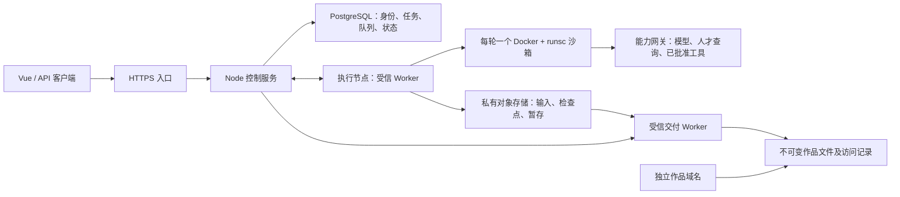

# 129 · 沙箱二期重建架构与迁移计划

**状态**：建议方案，待实现（2026-11-23）。已核对代码、既有手记和本机运行时配置，11-24 复验基础运行时，见下文。待做 Pi 容器化、故障注入、容量验证和切流。业务和部署均未改动。

## 目标与范围

面向互不信任的外部用户提供技能广场。复用 Vue 页面、技能脚本、Pi RPC 事件映射和报告生成逻辑。在同一仓库中建设独立部署的新控制服务、新执行节点及数据空间。沿用 [119](119-multi-user-gvisor-workspaces.md) 的隔离目标、[120](120-persistent-execution-and-stable-publications.md) 的新会话续聊及长期链接要求、[121](121-sandbox-architecture-reliability-review.md) 的故障验收。

本轮规划按空库启用新会话：跳过旧聊天、旧运行索引、原生 Pi 会话文件、浏览器 ID 归属和旧工作区兼容。保留既有作品的长期链接需求，另以经核对的发布资产和路由处理。首期工作区与对话一对一，支持多轮聊天、附件、决策卡和静态报告。自定义镜像、用户任意安装依赖、常驻终端、对外开放容器端口和多机高可用另行评估。

## 核对到的现状

| 当前接入点 | 对重建的影响 |
| --- | --- |
| `web/server/lib/piRunner.ts:537` 通过本机 `JsonlChannel` 启动 Pi，使用工作区内 `.pi-sessions` 和 `--continue` | 复用 Pi RPC 映射、技能注册及扩展选择，替换执行、会话恢复和超时控制 |
| `scripts/setup-pi-sandbox.sh:99` 的共享组工作区和 `:103` 的 `web/.env` 读 ACL；`web/server/lib/modelRelay.ts:8` 的回环模型代理 | 新环境需实现租户级边界，将模型和查询服务改为受信网关 |
| `web/server/index.ts:114` 的内存执行状态、`:340` 的共享历史入口、`:1650` 的断线中止 | 新服务从登录态决定归属，独立持久化任务和订阅状态 |
| `web/server/lib/delivery.ts:82` 的交付校验及 `web/server/index.ts:287` 的同进程网页读取 | 沿用清单形状和变化检测，把收集、发布和读取移到独立边界 |
| `web/server/lib/skills.ts:143` 的伴生挂载及 [T03 手记](124-training-program-design-skill.md) 的轮次输入和本地语料 | 镜像和数据按技能版本发放，保持证据核验、决策和 T05 交接可用 |

本机只读检查见 Docker 已注册 `runsc`（`release-20261102.0`），默认 runtime 仍是 `runc`，Docker 使用 cgroup v2/systemd，当前项目盘显示 ext4 `rw,relatime`。前后端用户服务均为 active。Docker 的 cgroup driver 不能单独证明 runsc 的 cgroup 配置或限制效果，项目盘状态也不能证明已启用硬配额。历史基础探针见 119/121。

### 2026-11-24 运行时复验

- 本机已有的 `alpine:latest` 使用 `docker run --rm --pull=never --runtime=runsc --network=none alpine:latest uname -r` 返回 `4.19.0-gvisor`。临时宿主目录可由非 root 容器写入，重建后可以读回，改为只读挂载后覆盖被拒。无网络模式下未见 IPv4/IPv6 默认路由。
- `--read-only` 生效时，本机 runsc 仍给 `/tmp` 单独提供可写 tmpfs。执行器应显式给临时目录设置上限。附加 `--tmpfs /tmp:rw,nosuid,nodev,noexec,size=16m,mode=1777` 后，经限量写入确认文件到 16 MiB 即无法继续增长。bind mount 的宿主机硬配额仍需独立实现和验证。
- 设置 `--cpus=0.5 --memory=256m --pids-limit=64` 后，Docker 报告的宿主机进程所在 cgroup 实读为 `cpu.max=50000 100000`、`memory.max=268435456`、`pids.max=64`。本机 runsc 沙箱内的 `/sys/fs/cgroup/pids/pids.max` 则报告 `max`。验收应分开检查宿主进程和沙箱内部任务上限，不能用前者代替后者。
- 上述容器和临时目录均已回收。广场仍由 `web/server/lib/piRunner.ts:580` 的宿主机 Pi 执行路径提供服务。此复验覆盖本机 Docker/runsc，不代表技能端到端、网络网关、跨租户隔离或故障恢复已经验收。

## 部署拓扑和职责

开发和内测可在本机用独立的配置、服务名和数据目录并行起服务。对外首期至少分出控制节点与专用 Linux 执行节点，数据库、对象存储和作品读取部署在执行节点之外。控制节点托管 Vue 构建产物、反向代理、Node API 和网关。发布 Worker 单独进程和服务账号，可和控制节点共置。作品读取通过独立的站点和进程，运行节点或聊天 API 停机时仍能读已发布内容，首期仍依赖作品存储和发布元数据可用。每个节点通过 systemd 管理自己的服务，私网服务间认证并隔离，不共享旧服务凭据或数据目录。部署仓库建议新增 `deploy/sandbox-v2/`，生产由 CI 产生固定版本镜像、数据库迁移及可回退的服务包。

- **身份与控制**：浏览器以受信 OIDC 登录建立服务端会话，已有统一登录时优先复用。API 使用有作用域、可撤销的服务凭据。所有者、租户和角色由服务端计算。聊天、工作区、任务详情、事件、上传、下载、导出、取消、决策卡、发布和管理员访问逐项授权。首期个人独占工作区，团队协作按产品需要单独定义 ACL。
- **执行与管理**：Worker 使用独立服务身份通过私网领取任务并回报状态。Docker socket 只给执行节点上的受信 Worker，按宿主机管理权限对待。控制 API、Pi、用户脚本与发布服务均无 Docker 权限。执行请求只接收服务端签发的固定镜像、目录、网络和额度参数。为 runsc 显式指定、核验运行时，启动失败即失败。适配接口覆盖 `prepare/start/inspect/cancel/collect/cleanup`。
- **能力网关**：Pi 从受限沙箱网络仅能访问所需内部能力端点。模型代理按 `attemptId`、允许的 provider/model、有效期和额度签发可撤销能力，主密钥留在网关。人才查询网关复用现有受管参数、指标白名单、数据来源及脱敏约定，使用只读最小权限账号。WeKnora、官方资料读取和微信分别在受信服务实现。通用外网默认关闭。确需公开资料读取的技能走受控取文工具，按域名策略、解析地址、跳转目标和响应大小逐次约束。隔离策略覆盖容器间、宿主机、管理/API/数据库、内网和 IPv6，部署于宿主机/网络并实际验证。短期能力按沙箱内程序均可读取来设计。
- **运行环境**：维护带版本的基础镜像和报告/排课/PDF等必要工具组合，锁定镜像 digest、Pi 版本、技能及工具包。技能快照只读并关闭自动发现，可信提示与用户工作区分开。只挂本轮可写目录、只读用户附件、经授权且版本化的语料和有界临时空间。非 root、只读根文件系统、取消特权与不需要的 capability。限 CPU、内存、宿主进程和沙箱内任务数、时间、文件容量与 inode、日志、网络、模型调用、租户并发和队列深度。工作盘采用验证过的块与 inode 硬配额或有界独立卷；先证明 Sentry/Gofer、容器子进程和临时文件都受控，再开放并发。
- **持久存储**：PostgreSQL 是权限、任务和版本指针的权威。S3 兼容对象存储保存私有上传、已提交的工作区文件版本、Pi 原生检查点、暂存和不可变产物。沙箱不得持有对象存储账户。Worker 通过受信文件接口按工单发放输入、提交限定前缀的暂存，发布 Worker 独立校验和写入最终作品。短期暂存、历史检查点、已发布作品和备份各自清理，回收前检查引用。试点先做有上限的文件清单和独立工作目录，量上来再优化差量或快照。

## 数据与接口契约

| 对象 | 权威字段和约束 |
| --- | --- |
| Tenant / Membership / Workspace | `tenantId, userId, role` 来自认证，`workspaceId, ownerUserId, environmentRevisionId, headRevision` 由控制服务管理 |
| Conversation / Message / PendingQuestion | 对话关联 workspace、原生检查点和最新提交轮次；消息有 `messageId` 和上传引用；问题绑定 `questionId, sourceRunId, revision, state`，同工作区同一有效问题只能接受一次 |
| Run / Job / Attempt | `runId, requestId, inputHash, baseRevision, status, deadlineAt`，同工作区请求键唯一；保留 `attemptId, workerId, sandboxId, generation, heartbeatAt, errorCode` 等执行事实 |
| RunEvent | 按 run 的单调 `seq` 持久重放，按 `(attemptId, producerSeq)` 去重。仅映射白名单事件，内部日志单独授权 |
| WorkspaceRevision / EnvironmentRevision | 文件清单和哈希、明确的 Pi 会话 ID/原生检查点和格式版本、镜像/工具/技能 digest 组成可恢复组合 |
| ArtifactVersion / Publication | 所有权、`sourceRunId, artifactVersionId, manifest, visibility, state`。作品版本不可变，分享地址固定并可撤销 |

建议新 API 提供 `POST /api/v2/conversations/:id/runs`、`GET /api/v2/runs/:id`、`GET /api/v2/runs/:id/events`、`POST /api/v2/runs/:id/cancel`、独立上传与发布接口。提交用幂等键，返回 `202` 和 `runId`。SSE 依据 `Last-Event-ID` 或游标续读，事件落库后才推送，可批量合并文本事件。连接断开只结束订阅。普通网页使用新接口，`/v1/chat/completions` 可由薄适配层复用同一授权和任务通道，流式与非流式保持对已承诺客户端的输出行为。兼容入口同样要求服务凭据，外部 messages 不能覆盖已存历史或冒充已确认的人工答复。外部调用方若依赖旧会话 ID，改用新绑定。

### 单轮生命周期与恢复

1. 校验归属、技能版本、附件和额度。把当前用户消息、Run、待执行 Job 及问题答复的消费，在一个数据库事务内提交。相同请求键与输入返回原任务，输入不同返回冲突。Job 可由 PostgreSQL 事务领取，租户准入和同会话单轮写入也由事务约束。首期用 `FOR UPDATE SKIP LOCKED` 领取作业，公平性及可恢复性由调度策略和状态机负责。
2. Worker 创建独立的 attempt 目录和 runsc 实例，加载最后已提交的工作区文件和指定的 Pi 原生检查点。Pi 就绪后只发本轮新消息，避免把旧聊天重复拼进 prompt。启动时检查 Pi 版本和恢复的会话 ID，恢复失败按明确错误返回。每轮之间销毁容器，以数据版本续聊。
3. 执行状态采用 `queued → preparing → running → persisting → completed`。失败、取消、失联分别记录。产生决策卡时，本轮以问题为结果提交检查点和问题记录、释放执行名额，对话等待用户回答。回答到达后建立新 Run，后续重试引用已接收的答复。取消写入持久状态，由 Worker 幂等停止整个容器并核对退出。心跳消失先进入核查，撤销该次能力。旧 attempt 只能写自己的目录，不能覆盖现有版本。过期 generation 的完成、发布和状态更新一律拒绝。
4. 轮次结束后等 Pi 写完检查点并停止整个容器，再从静止视图按清单收集文件。上传私有不可变数据并校验后，在数据库同一事务内条件提交会话检查点、文件版本和该轮必需的私有交付引用，随后发终态 SSE。发布打包失败可以从已校验的暂存重试，生成步骤无需重跑。未引用的暂存延时回收。执行中断保留上一轮成功状态，界面标明本轮未提交。资源或供应商调用的不确定结果保留记录，禁止自动重放已开始的模型或外部写操作；准备阶段和已暂存的提交按有界幂等策略重试。取消与完成竞争用状态版本裁决。

### 文件、分享和日常运维

沿用 `delivery.json` 表达本轮产物，视为交付候选。校验工作区相对路径、普通文件、入口、文件数和容量，明确可发布目录，拒绝符号链接、越界路径、特殊文件以及原始上传、会话与日志。私有成果默认仅所有者可读，显式分享前向用户展示将发布的资产集合。发布仅在文件完整且权限记录已提交后可读，更新内容产生新版本。稳定 URL 由作品读取服务解析，临时签名仅用于私有读取授权。报告 HTML 在与主站隔离的作品 origin 上提供，隔离主站 cookie 和 API，采用适配现有静态资源的 CSP 及沙箱策略，私有资源按作品授权并控制缓存，测试撤销、资源授权及缓存失效。

日志统一串起 `runId / attemptId / traceId`，分开记录排队、镜像准备、模型、工具、提交和发布。持续监控队列深度、启动时延、执行/发布失败率、配额、CPU/内存/磁盘、上游成本和已发布网页可用性。敏感正文、密钥及原始附件不进入普通日志。容量测试先用单任务测 Pi 与重型工具的峰值及 p95 排队、准备和收尾耗时，再逐步增加并发并为节点保留余量。数据库与对象存储做异机备份，按恢复清单一起恢复并抽查作品 URL 与指定会话。首期无整机高可用承诺，RPO/RTO 和并发目标在实测及恢复演练后确定。发布镜像版本不变，升级前停止领取并排空 Worker，新旧 Pi 版本只在检查点兼容经验证后切换。

## 技能迁移与验收

| 顺序 | 验收链路 |
| --- | --- |
| 第一批 | 普通多轮对话和 **T03 产教培养方案设计**。真实语料索引及语料哈希，决策卡跨容器续聊，受管人才取数工件和原有校验，方案全文网页、Word、证据附录及 T05 任务包下载。保留 `program-input.json` 和 `talent-query-turn.json` 的业务契约，权威用户确认及网关数据回执另由平台保存。验证跨工作区向 T05 导入时显式选择并校验所有权 |
| 第二批 | 文档翻译核验 XeLaTeX、字体和 PDF 源图保留。排课核验求解器、资源峰值、Excel 和 ICS。课件核验 PPTX 与教师确认。逐项验证其余已上架技能的附件、持久状态、网关依赖和交付格式 |
| 对外连接 | 迁移仍在使用的 OpenAI 兼容调用方并验证鉴权、流式/非流式和错误协议。公众号走受信连接器，保留明确的人类确认、草稿回执核查、专用出网；外部动作未知时不自动重放。切流时以已登记调用方和迁移核对表为准 |

公网前须完成下列验证，并记录实际镜像与样本、结果和限制。

| 验收面 | 通过标准 |
| --- | --- |
| 双租户 | 用两个真实测试账号和 API 身份验证对方会话、附件、运行、事件、取消、下载、发布均拒绝。沙箱内无法接触工作目录之外的租户数据、宿主敏感路径、Docker、管理网或长期凭据 |
| 执行和模型 | 默认无直接外网。网络限制在 IPv4/IPv6、网关不可用时仍生效。额度用完和吊销后拒绝请求。压测 CPU、内存、内部进程、日志、磁盘容量及 inode 上限，控制服务和作品读取稳定 |
| 持久执行 | 双提交只入队一次。关网页后任务继续，重连补齐事件。模拟 API/Worker 中断、过期回执、取消与提交竞争和发布中断，找得到已提交结果且无双写、无半成品或错误终态 |
| 业务交付 | T03、PDF、排课及每个拟上架技能以真实依赖跑通，检查网页、下载和关键后续动作。公开/私有作品经过授权、撤销和浏览器资源加载检查，停止 Worker 和聊天 API 后已发布网页仍可读 |
| 恢复和回退 | 从异机备份恢复指定新会话、资产完整性与旧链接映射，记录实际 RPO/RTO。演练停止新入口后仍能找回已生成的新版作品和记录 |

## 迁移与切流

以下是按一名熟悉仓库的工程师、单执行节点估算的人日。包括实现和验收，取决于身份接入、技能范围和基础设施准备；外部系统审批、多机高可用及全部技能的缺陷修复另计。

| 阶段 | 工作及退出条件 | 人日 |
| --- | --- | --- |
| 0. 盘点 | 定义两节点、认证、数据库/存储、保留作品和必须兼容的客户端。记录当前代表任务耗时、产物和峰值，建立预发域名及全新 DB/Bucket | 2–3 |
| 1. 可行性验证 | 在独立服务用 runsc 跑通非 root Pi、内部网关、容器资源限制和真实 Pi RPC。试跑 T03 关键工具及重型 PDF/渲染依赖。记录权限和依赖问题 | 5–8 |
| 2. 控制和隔离 | 实现账号、资源所有权、事务队列、并发/配额、Worker 生命周期、SSE 和取消。完成跨用户鉴权与故障测试 | 6–9 |
| 3. 状态和交付 | 实现原生检查点、工作区版本、上传、不可变作品、发布读服务、备份及回滚。完成 T03 全链路及续聊 | 7–10 |
| 4. 技能批次与验收 | 按调用量、工具依赖、外部副作用分批接入，验收真实业务、资源耗尽和已登记兼容客户端。完成恢复演练 | 5–10 |
| 5. 灰度和迁出 | 以邀请用户验证新服务，然后停止旧会话入口新增任务、排空在途运行、切换入口并继续观察，再撤掉旧执行入口 | 4–6 |

首期计划约 **29–46 人日**。阶段 1 后由实测确定资源配置、工具兼容性和其余技能的交付时间。

切流前按四类整理数据。

- **迁入或重配**：仓库中技能和静态构建、确需的版本化语料、公开配置、上线技能列表、部署域名及调用方设置；重新签发服务账号和密钥。新库为空，导入内容有来源和校验值。
- **冷归档旧系统**：旧聊天、执行 trace、附件、Pi 状态和工作区按内部保留周期做受限归档。新版历史页面从零开始，旧共享历史只在受保护的旧内部环境按现有授权处理。
- **单独保留分享作品**：核对旧 `/p/` 作品清单、已公开属性、路径、资源及校验值。已确认可公开的作品和别名迁到只读归档站，通过原路径代理或重定向保持外部链接；未确认公开权限的作品进入受限库。至少抽验 HTML、相对资源、下载和原地址。旧作品链接处理独立于切换聊天 API。
- **外部入口**：固定对外域名和路由，通过反向代理切换前端、API 及作品路径。公众号在原可信服务上过渡或迁移后再切凭据与回调合同。避免同时向两套外部写流程分发同一事件。

建议切流顺序为预发内测 → 邀请用户灰度 → 旧执行排空 → 反向代理切新入口 → 观察 → 归档下线。保留新旧独立环境和已验证的部署包。跨租户隔离失败、任务状态不可恢复或发布权限异常时，暂停新提交并停派任务，执行节点隔离，对账已提交结果；入口切到维护页、单独的旧内部入口或上一版已验收的沙箱部署。不得把外部用户流量回退到旧共享历史和宿主机执行。保留新版数据和作品，修复后恢复新入口。旧低权进程退役后撤销不再需要的 ACL、sudoers 和旧凭据。

## 取舍与进一步扩展

保留业务并重建控制/执行是一条比全产品重写更小的迁移路径。每轮独占目录和文件版本增加复制与对象存储成本，换来清晰的崩溃和回滚语义；先通过文件量限制、不可变文件复用和代表任务压测控制成本。选择本机已有基础的 Docker/runsc，运行时验证不通过的负载应单独评估隔离方案，必要时用专用 VM 或 microVM。首期数据库队列便于任务和消息同时提交，后续排队复杂度、执行节点规模或可用性要求明确后，再考虑工作流引擎、多节点调度和共享存储容量。

## 参考

- [gVisor 安全模型](https://gvisor.dev/docs/architecture_guide/security/) 和 [systemd cgroup 指南](https://gvisor.dev/docs/user_guide/systemd/)。gVisor 的隔离范围、宿主机资源约束和 cgroup 生效条件。
- [Docker 防火墙文档](https://docs.docker.com/engine/network/packet-filtering-firewalls/)。容器网络规则和 Docker 与宿主机防火墙的交互。
- [PostgreSQL SELECT 锁定子句](https://www.postgresql.org/docs/current/sql-select.html#SQL-FOR-UPDATE-SHARE)。队列多消费者使用 `SKIP LOCKED` 的语义。
