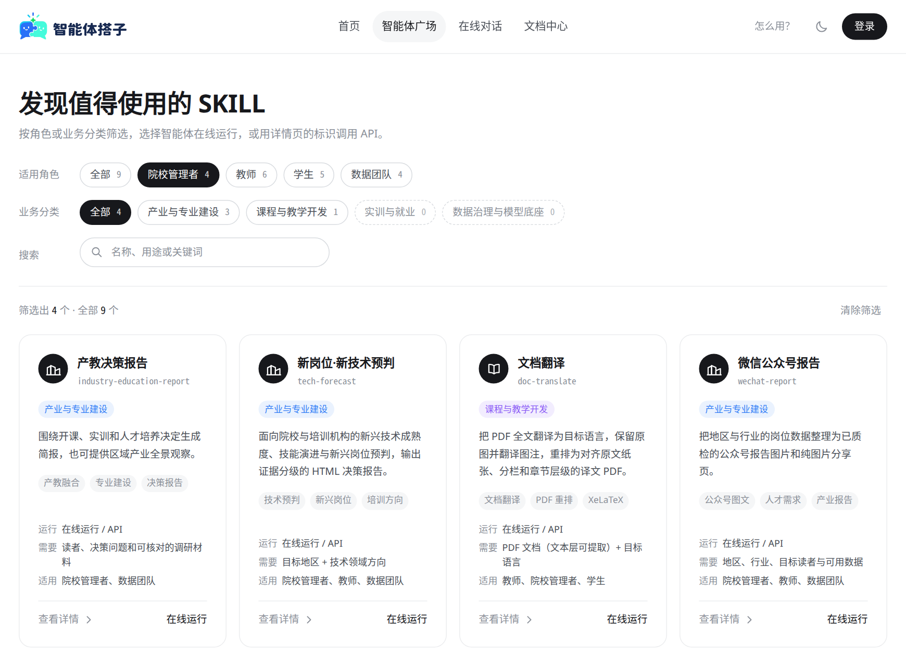
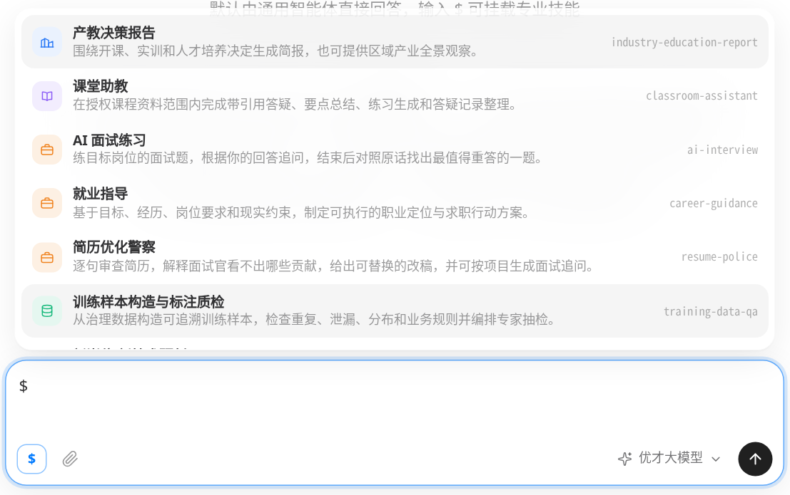
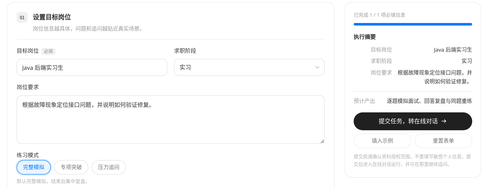
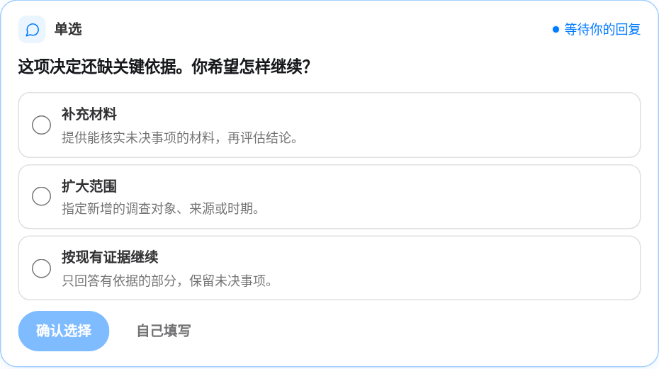
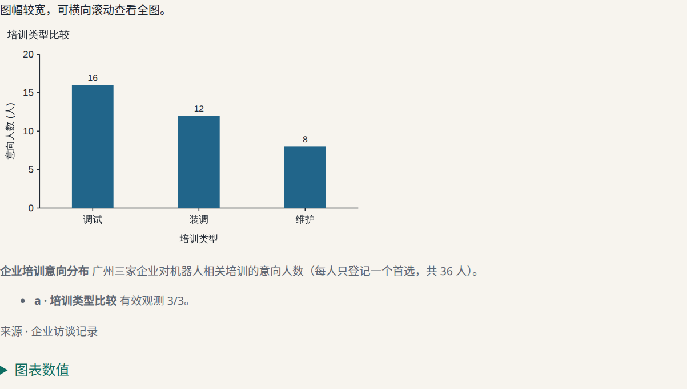
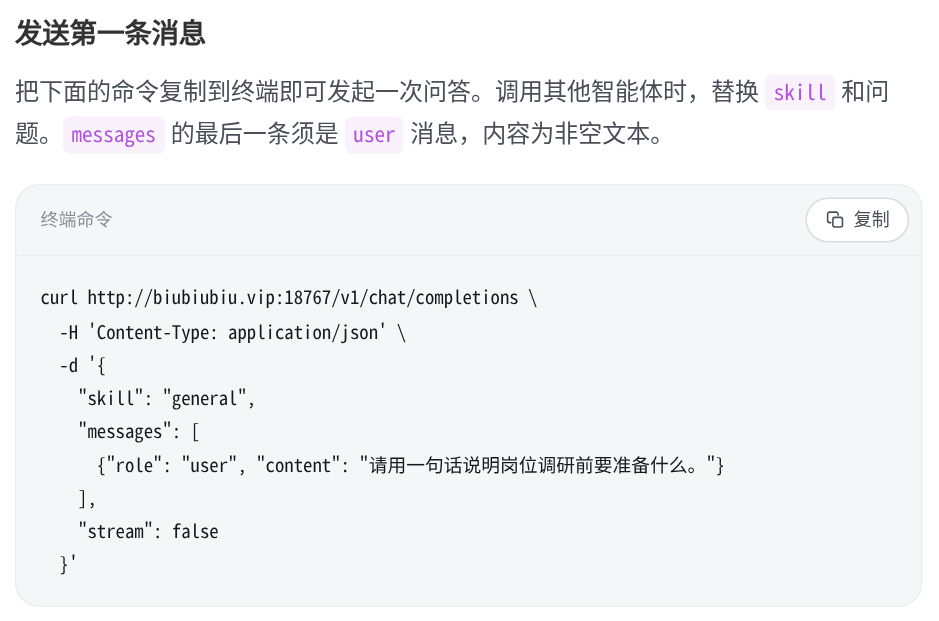

# 智能体搭子

从工作流到通用 Agent 的产教实践

项目介绍 · 2026 年 11 月 6 日

## 固定工作流能走到哪一步？

高职院校要决定下学期是否增开机器人调试实训班。企业访谈显示有培训需求，排课表却显示唯一的实训室已经排满。如果流程只安排了“统计需求、撰写建议、导出报告”三步，最后就可能得到一份看起来完整、却无法用于开班的报告。这里真正需要判断的是，下一步应该查招聘数据、索要排课表，还是已经有足够依据建议暂缓。

**工作流的优势在于步骤可预先约定。** 例如，同一批材料都要校验格式、汇总字段并导出文件，固定顺序便于逐步验收。任务越依赖现场证据，预设路径的局限越明显。下表是把 Anthropic 对工作流和 Agent 的架构区分应用到院校场景后得出的判断。[Anthropic《Building effective agents》](https://www.anthropic.com/research/building-effective-agents)

| 遇到的情况 | 固定路径的局限 |
| --- | --- |
| 输入缺项 | 企业访谈能说明培训意向，却不能回答工位是否可用。只校验“是否上传材料”，仍可能让无依据的建议进入下一步。 |
| 中途出现相反证据 | 排课表足以改变开班结论。若流程没有为这个条件设置暂停或回退，后续节点会继续沿用原先的假设。 |
| 任务换了对象 | 同样是“人才需求”，园区关心岗位分布，学校还要考虑师资和设备。每增加一种处理方式，都要同步维护相关分支及其验收条件。 |
| 串行步骤耗时过长 | 扣子的商店与智能体调试区对单次对话设有 10 分钟上限。耗时工作流再叠加工具调用和模型总结，可能使整轮超时。[扣子开发 FAQ](https://docs.coze.cn/guides_FAQ) |

### 扣子案例中的平台依赖

2026 年 7 月 1 日，扣子关闭了低代码智能体发布到豆包的入口，已发布的智能体可继续使用。10 月 29 日，扣子公布企业套餐调整计划。企业标准版和旗舰版拟于当年 11 月 30 日起暂停接受新客户购买。在火山引擎购买的指定旧套餐拟于当年 12 月 31 日下线，新版企业套餐拟于 2027 年 12 月 31 日下线。扣子编程仍支持创建工作流。[发布渠道 FAQ](https://docs.coze.cn/guides_FAQ) · [企业版下线公告](https://docs.coze.cn/enterprise-plan-discontinuation-notice) · [扣子产品问答](https://docs.coze.cn/cozespace_coze_app_faq)

对学校而言，需要盘点的是迁移时能带走什么。扣子支持导出流程，但跨空间导入时，知识库、数据库和私有插件仍需重新选择。这个案例说明，即使执行逻辑正确，渠道和外部资源仍可能决定一个应用能在哪里继续运行。[扣子《导入与导出低代码工作流》](https://docs.coze.cn/guides_import_and_export_workflow)

---

## 通用 Agent 如何根据结果改变下一步

通用 Agent（智能体）接受目标，调用工具后读取结果，再决定继续、换一种取证方式或请人作出选择。它的优势集中在步骤难以预先穷举的任务。多轮调用也会增加时间和成本，错误可能逐步累积，因此长任务尤其需要限定工具权限、设定停止条件，并验证最终交付。[Anthropic《Building effective agents》](https://www.anthropic.com/research/building-effective-agents)

| 技术进展 | 对实际任务有什么用 |
| --- | --- |
| **2022.10 · ReAct** | 研究者让模型在推理与行动之间交替，把外部查询得到的信息带回下一步。查到的证据可以改变原先的计划。[ReAct 原论文](https://arxiv.org/abs/2210.03629) |
| **2024.11 · MCP** | 模型上下文协议为工具和数据源提供共同的接入方式。不同应用可以复用连接能力，减少为每一组系统重写连接代码的工作。[MCP 发布说明](https://www.anthropic.com/news/model-context-protocol) |
| **2025.10 · Agent Skills** | 团队可将领域说明、脚本和参考资料放入技能目录，供智能体按需加载。同一个执行环境由此能服务不同专业任务。[Agent Skills 技术说明](https://www.anthropic.com/research/equipping-agents-for-the-real-world-with-agent-skills) |
| **2026.04 · 可恢复的长任务** | Anthropic 的 Managed Agents 将会话记录、调度模型与工具的循环、执行环境分开。进程出错后，可用持久记录恢复工作。[Managed Agents 工程实践](https://www.anthropic.com/research/managed-agents) |

### 项目如何把通用能力用在产教任务上

**智能体搭子**是面向院校与产教服务团队的智能体广场。团队把岗位统计口径、教学材料要求和报告验收规则随技能保存在项目仓库里，让不同任务复用同一套 Pi 执行环境。岗位范围可以随提问变化，统计和交付仍有明确的检查方法。

**使用者选目标。** 学生可练习一场面试，教师可整理授权课程资料，专业负责人可评估一门实训课。网页提供通用对话，也允许用户用 `$` 选择专业技能。业务系统可以通过 API 指定同一个技能。

**技能规定证据，Pi 执行任务。** 以产教报告为例，岗位统计交给人才查询技能，报告技能对照产业需求和校内办学条件，渲染技能把核过的正文、图表和来源做成网页。需要岗位数据时按范围查询。只获准分析校内材料时，就围绕这些材料作答。

**影响结论的取舍由人作出。** 如果缺的是能决定是否开班的排课表，系统先说明缺口，等用户补材料、指定扩大范围，或明确按现有证据继续。文件生成后，平台还要核对网页和下载原件是否实际可交付。[项目《产教决策报告使用指南》](../../.agents/skills/industry-education-report/docs/index.md)

---

## 在广场里，按要做的事找到技能

广场可以按角色、业务类别或关键词筛选。每张卡片写明需要的材料、适用对象和进入方式。例如，院校管理者可以先看产教决策报告。如果想判断某项新技术值得开设哪类课程，则可打开新岗位·新技术预判。

*图 1　智能体广场实拍。选中“院校管理者”后，9 个公开入口中有 4 个匹配。*

| 面向的任务 | 当前可以做什么 |
| --- | --- |
| 产业与专业建设 | **产教决策报告**比较需求与开办条件。**新岗位·新技术预判**区分当前信号和未来判断。**微信公众号报告**把地区岗位统计做成可分享的图片。 |
| 课程与教学开发 | **课堂助教**在教师授权的材料范围内答疑、出练习并注明出处。**文档翻译**接收带文本层的 PDF，保留原图、翻译图注，交付译文 PDF。 |
| 实训与就业 | **就业指导**用岗位要求对照经历，形成求职计划。**简历优化警察**逐句给出可替换的改稿。**AI 面试练习**按真实作答追问，支持同题重答。 |
| 数据治理与模型底座 | **训练样本构造与标注质检**按任务规则组织样本，检查字段、重复和训练集与评测集之间的数据泄漏。 |

---

## 从第一次提问到同题重答

用户可以直接在在线对话输入问题，也可以从广场进入任务表单。以求职练习为例，已经知道自己想练什么，可以直接挂载“AI 面试练习”。需要整理岗位要求时，表单会提示要准备哪些信息。

*图 2　在线对话输入 `$` 后显示技能名称和用途。选择技能，再输入本次任务。*

*图 3　AI 面试练习的示例表单。目标为 Java 后端实习生，岗位要求包含定位接口问题和验证修复。*

提交后，智能体一次提出一道主问题，根据学生刚才的回答追问。在一次汽车故障排查练习中，学生初答只说小组解决了问题。重答时，他区分了自己读取故障码、核对手册与组长更换接头的分工，还说明没有记录修复耗时。教师由此能判断学生亲手做过哪一步，并据此安排下一题。[项目面试练习记录](../../.agents/skills/plaza-dev-notes/references/108-ai-interview-practice.md)

---

## 实训班能不能开，由哪份材料决定？

产教报告把企业需求和学校实施条件分开核对。若关键依据缺失，用户会在对话里看到选择卡。在一段广州智能网联汽车实训课调研对话中，用户明确尚未提供本校师资和场地情况，系统留下了下面的待回复卡。

*图 4　实训课调研对话的选择卡。扩大范围后会重新评估证据。按现有证据继续时，缺证事项会保留为未决。*

### 机器人调试班为何暂缓

在另一场使用**模拟教学材料**的演练里，广州某高职院校申请下学期增开 18 人机器人调试实训班。第一轮只有企业访谈，智能体请用户补充材料。校方随后提供了排课表，确认唯一实训室的 20 个工位均已排满，无法调课或借用其他场地。

**报告建议暂缓新增。** 三家企业的 36 名受访者中，有 16 人首选调试培训，表明有人愿意参加这项培训。学校本期能否开班，取决于能否腾出工位。报告提出先在已有课程中补充故障记录训练，取得可用场地并核对排课表后，再评估增班。

*图 5　模拟演练的实际交付网页。首页把 18 人开班问题、暂缓结论和模拟范围放在一起。*

---

## 交付物怎样复核，应用怎样接入

在上述演练中，读者可以打开完整报告网页，也可以下载报告正文、结构化报告、结构验收结果和证据复核记录四份原件。读者可以沿着结论回到材料，检查数字所代表的对象。下图统计的是**培训意向人数**。若据此估算招聘空缺，就改变了指标的含义。[项目交付核验记录](../../.agents/skills/plaza-dev-notes/references/116-industry-full-web-delivery.md)

*图 6　报告中的培训意向分布。每位受访者只登记一个首选，共 36 人。*

### 网页和 API 使用同一套技能

网页用户可在会话中查看执行过程、继续历史对话、打开网页或下载文件。应用开发者先从 `GET /api/skills` 取得技能标识，再向 `POST /v1/chat/completions` 发送 `skill` 和 `messages`。长任务可用服务器发送事件（SSE）逐步接收进度和回答，再从 `webLinks` 和 `downloads` 读取成品地址。继续对话时沿用同一 `sessionId`。[项目《在线运行与 API 指南》](../guide.md)

*图 7　文档中心提供可复制的请求示例。示例调用通用入口，替换技能标识即可发给专业智能体。*

---

## 项目参数

本机运行参数核实于 2026 年 11 月 6 日。技能数取自服务当日公开清单，模型数取自健康接口。产业目录使用其自身的快照日期。

| 项目 | 核实结果 |
| --- | --- |
| 项目与读者 | **智能体搭子 · 产教智能体广场**。面向院校管理者、教师、学生与数据团队，支持网页和 API 两种接入方式。 |
| 公开能力 | **4 类、9 项专业入口**。7 项按独立技能包加载。课堂助教、训练样本构造与标注质检使用内置提示词。另有默认通用入口 `general`。 |
| 模型与执行 | 本机配置的 **3 个模型**为优才之路产教融合大模型（本机默认）、DeepSeek Flash、DeepSeek Pro。引擎为 **Pi 0.87.1**，通过 RPC 驱动会话。 |
| 前后端 | 前端采用 Vue 3、TypeScript、Vite，后端使用 Node.js 原生 HTTP 服务。本机 Node.js **22.18.0**。前端与后端由两个独立的 systemd 用户服务运行。 |
| 本机入口 | 前端 `127.0.0.1:4188`，后端 `127.0.0.1:8767`。网页对话通过 `/api/chat` 流式返回。应用接入使用 `/v1/chat/completions`，支持 JSON 或 SSE。 |
| 人才数据 | **2026-11-03 产业链岗位目录快照**收录 49 个产业、2,713 个岗位名称、3,590 个岗位节点。名称可对应多个节点。招聘量、学历、薪酬等另按范围查询人才数据库。 |
| 材料输入 | 上传接口单文件上限 **6 MiB**，支持 PDF、DOCX、DOC、MD、TXT。各任务可进一步限定类型，例如文档翻译要求可提取文本的未加密 PDF。 |
| 成品形式 | 随技能交付对话反馈、可分享的报告网页、图片或译文 PDF。产教决策报告默认交付完整网页及四份可复核原件。 |
| 运行与使用边界 | Pi 以低权系统用户运行，任务资料按会话工作区保存。当前部署面向内网协作，前台历史对访客共享，管理员可查看原始运行记录，管理技能上架和模型配置。 |

**复核入口。** 运行参数可在服务的 `/api/health`、`/api/skills` 查阅。代码与快照可从仓库的[运行说明](../../README.md)、[技能注册](../../web/server/lib/skills.ts)、[上传接口](../../web/server/index.ts)和[产业链岗位目录](../../.agents/skills/talent-data-query/data/position-catalog.json)核对。
